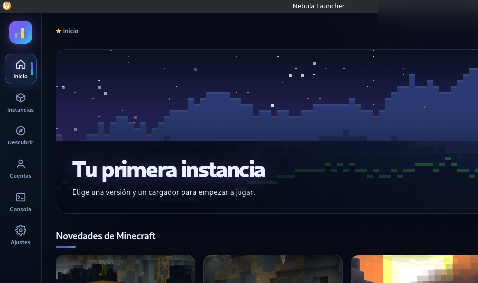
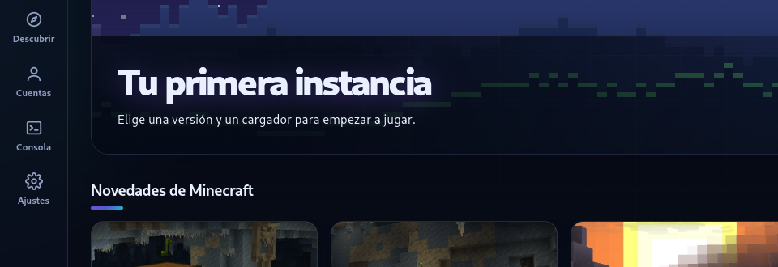

# 🌌 Nebula Launcher



Lanzador de Minecraft Java **de código abierto** para Linux y Windows, hecho con **Tauri 2 (Rust)** y una interfaz web nativa sin Node. Ligero (~10 MB de instalador, RAM mínima), bonito y completo.

[](https://github.com/mclovin552/nebula-launcher/releases/latest)
[](https://github.com/mclovin552/nebula-launcher/releases)
[](LICENSE)
[](#instalaci%C3%B3n)

> ✨ Tema **Aurora**: interfaz de vidrio con degradados violeta/cian, animaciones fluidas, Modrinth integrado, backups automáticos, estadísticas de juego y más.

---

## 📸 Vistazo rápido

| Inicio | Novedades de Minecraft |
|---|---|
|  |  |

## 🚀 Funciones

- **Gestión de instancias**: vanilla, Fabric, Quilt, Forge y NeoForge, con grupos, colores, memoria y Java por instancia (más presets de JVM).
- **Modrinth integrado**: mods, modpacks (`.mrpack`), texturas y shaders, con resolución automática de dependencias y actualización de modpacks con un clic.
- **⚡ Optimizar**: instala de golpe los mods de rendimiento compatibles (Sodium, Lithium, Embeddium, ModernFix…).
- **Verificar y reparar**: comprobación SHA-1 de los archivos del juego y re-descarga de dañados.
- **Servidores**: ping real (MOTD, jugadores, latencia) y lista de servidores populares.
- **Skins y capas**: armario con vista 3D, cambio por API oficial y skins sin conexión vía CustomSkinLoader.
- **Capturas de pantalla**: galería integrada con tus capturas del juego.
- **Estadísticas**: tiempo de juego por instancia, favorita y totales.
- **Backups automáticos** de mundos mientras juegas.
- **Importación/Exportación**: instancias de Prism Launcher/MultiMC y modpacks de Modrinth; exporta como `.mrpack`.
- **Cuentas**: Microsoft (login OAuth local, sin configurar nada) y cuentas sin conexión.
- **Extras**: arrastrar para reordenar instancias, tema claro/oscuro, Discord Rich Presence, bandeja del sistema, consola integrada con diagnóstico de errores y sonidos de inicio.

## 📥 Instalación

Descarga el instalador desde [**Releases**](https://github.com/mclovin552/nebula-launcher/releases/latest):

| Sistema | Archivo |
|---|---|
| 🐧 Linux | `.AppImage` (portátil), `.deb` (Debian/Ubuntu), `.rpm` (Fedora/openSUSE) |
| 🪟 Windows | `.msi` (instalador) |

### Linux (AppImage)

```bash
chmod +x Nebula.Launcher_*_amd64.AppImage
./Nebula.Launcher_*_amd64.AppImage
```

## 🛠️ Compilar desde el código

Necesitas [Rust](https://rustup.rs) y las dependencias de Tauri 2:

```bash
# Debian/Ubuntu
sudo apt install libwebkit2gtk-4.1-dev build-essential libssl-dev libgtk-3-dev libayatana-appindicator3-dev librsvg2-dev

# Fedora
sudo dnf install webkit2gtk4.1-devel gcc-c++ openssl-devel gtk3-devel libappindicator-gtk3-devel librsvg2-devel
```

```bash
git clone https://github.com/mclovin552/nebula-launcher.git
cd nebula-launcher
cargo tauri build
```

## 🙏 Créditos

- [Tauri](https://tauri.app) y el ecosistema Rust
- [Modrinth](https://modrinth.com) y su API pública
- Inspirado en Prism Launcher y el ecosistema open source

## 📄 Licencia

[MIT](LICENSE) — haz lo que quieras, menciona el proyecto original.
