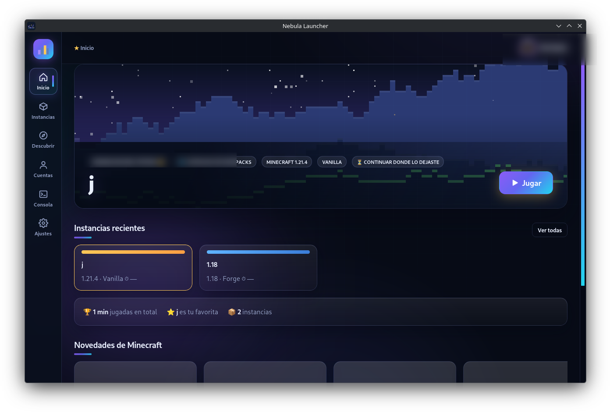
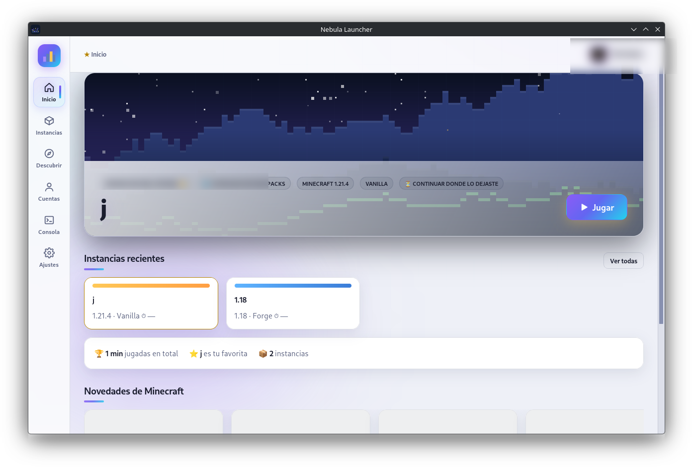
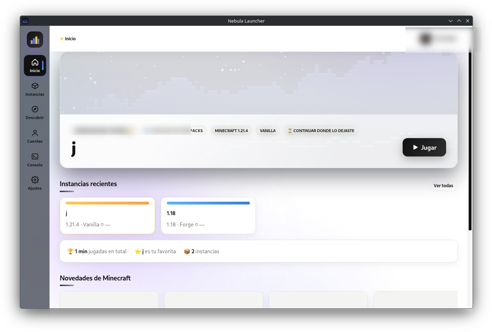
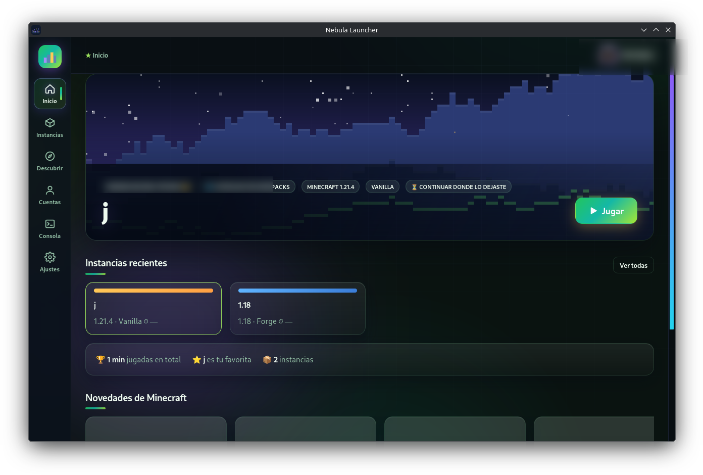
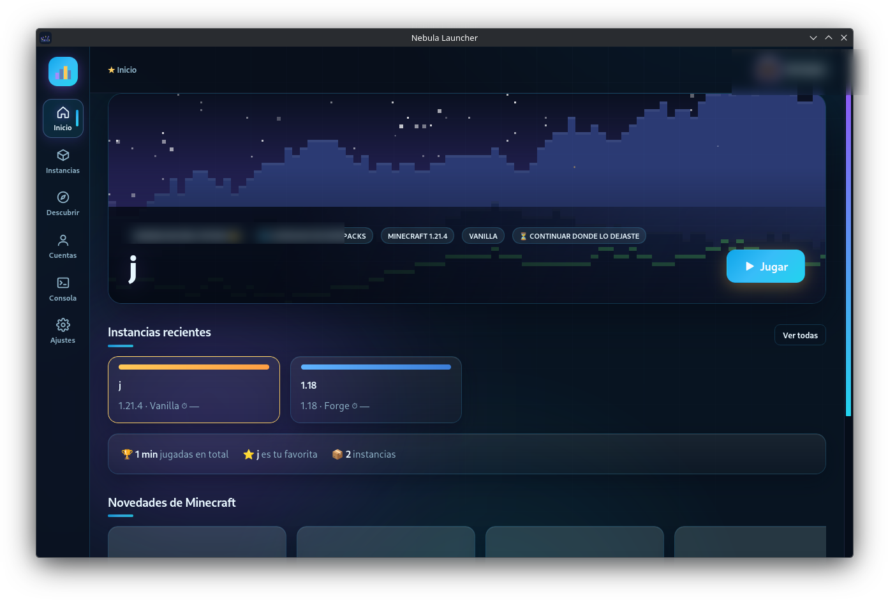
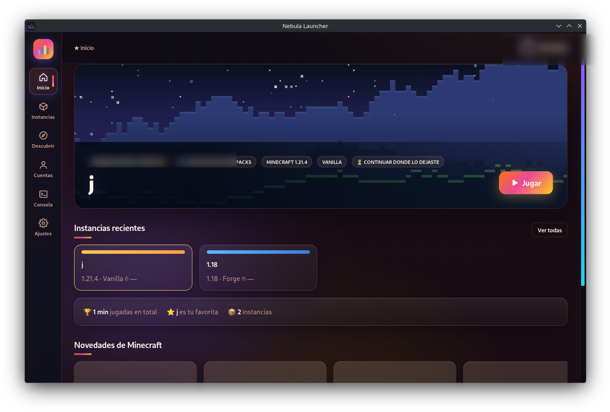

# 🌌 Nebula Launcher


Lanzador de Minecraft Java **de código abierto** para **Windows, Linux y macOS**, hecho con **Tauri 2 (Rust)** y una interfaz web nativa sin Node. Ligero (~10 MB de instalador), bonito, con efectos vivos y blindado con auditoría de seguridad.

🌐 **Página oficial de descargas:** [mclovin552.github.io/nebula-launcher](https://mclovin552.github.io/nebula-launcher/)

[](https://github.com/mclovin552/nebula-launcher/releases/latest)
[](https://github.com/mclovin552/nebula-launcher/releases)
[](LICENSE)
[](#instalaci%C3%B3n)

> ✨ Seis temas, una **nebulosa animada** flotando detrás de la interfaz, botón Jugar con pulso y tarjetas que entran deslizándose. Jugar ya no se ve aburrido.

---

## 🎨 Seis temas, elige tu outfit

*Clic en cada tema para verlo en grande (todas las capturas son del launcher real).*

| 🌌 [Aurora oscuro](docs/temas/tema-dark.png) | ☀️ [Aurora claro](docs/temas/tema-light.png) | ⬛ [Blanco y negro](docs/temas/tema-contrast.png) |
|:---:|:---:|:---:|
|  |  |  |
| 🌿 [Bosque](docs/temas/tema-forest.png) | 🌊 [Océano](docs/temas/tema-oceano.png) | 🌇 [Atardecer](docs/temas/tema-atardecer.png) |
|  |  |  |

*Los temas solo cambian colores — y el ojo también disfruta: fondo con nebulosa en movimiento, bloques que aparecen en cascada, chips con micro-animaciones y botones magnéticos. Se honra "reducir movimiento" del sistema.*

| Inicio | Novedades de Minecraft |
|---|---|
|  |  |

## 🚀 Funciones

- **Gestión de instancias**: vanilla, Fabric, Quilt, Forge y NeoForge, con grupos, colores, memoria y Java por instancia (más presets de JVM).
- **☕ Auto-Java**: el launcher detecta el Java que necesita cada versión, lo descarga oficial (Temurin) en 1 clic y hasta escanea los Javas que ya tengas instalados — un chip por instancia te dice si está listo.
- **🧳 Catálogo de modpacks en 1 clic**: desde el botón del inicio, elige portada y el launcher arma la instancia completa (mods, config, Java y todo).
- **Modrinth integrado**: mods, modpacks (`.mrpack`), texturas y shaders, con resolución automática de dependencias, **semáforo de actualizaciones** y actualización de modpacks con un clic. **⚡ Optimizar** mete los mods de rendimiento compatibles (Sodium, Lithium, Embeddium, ModernFix…) de golpe.
- **Verificar y reparar**: comprobación SHA-1 de los archivos del juego y re-descarga de dañados.
- **Servidores**: ping real (MOTD, jugadores, latencia), lista de servidores populares y entrada rápida (quickPlay).
- **Skins y capas**: armario con vista 3D, **galería online** con catálogo paginado (63 páginas, búsqueda real y respaldo por nick de Ely.by — sin cuenta extra), historial de "Skins usadas" para no perder ninguna, cambio por API oficial en cuentas premium y skins sin conexión vía CustomSkinLoader + feed local (aplicables a todas tus instancias con mods).
- **Capturas de pantalla**: galería integrada con tus capturas del juego.
- **Estadísticas**: tiempo de juego por instancia, favorita y totales.
- **Backups automáticos** de mundos mientras juegas.
- **Importación/Exportación**: instancias de Prism Launcher/MultiMC y modpacks de Modrinth; exporta como `.mrpack`.
- **Cuentas**: Microsoft (login OAuth local, sin configurar nada) y cuentas sin conexión.
- **Discord integrado**: muestra "Jugando a…" con tu instancia y versión usando la aplicación oficial de Nebula — sin configurar nada.
- **Más seguridad al iniciar sesión**: el login de Microsoft usa OAuth con **PKCE** y verificación de estado (state), ochava contra robo de código.
- **Extras**: 6 temas + 4 idiomas (ES/EN/PT/FR), bandeja del sistema, consola integrada con diagnóstico de errores, sonidos, **historial de versiones**, modo portátil (`portable.txt`) y **auto-actualización con un clic** en Windows y macOS.

## 📥 Instalación

### Windows
Descarga `Nebula.Launcher_*_x64-setup.exe` (o el `.msi`) desde [Releases](https://github.com/mclovin552/nebula-launcher/releases/latest) y siguiente-siguiente. Las actualizaciones futuras aparecen como un aviso discreto dentro del launcher y se instalan solas.

### Linux
Descarga el **AppImage** (dale permiso de ejecución), o instala `.deb` / `.rpm` con tu gestor de paquetes.

### macOS
Descarga el **`.dmg` universal** (sirve para Apple Silicon e Intel), abre, y arrastra Nebula Launcher a *Aplicaciones*.
> Primera apertura: si macOS avisa "no verificada" (no está firmado con cuenta de desarrollador de pago), clic derecho sobre la app → **Abrir**, o Ajustes → Privacidad y seguridad → *Abrir de todas formas*.

### Compilar desde fuente
```bash
git clone https://github.com/mclovin552/nebula-launcher
cd nebula-launcher/src-tauri
cargo build --release      # binario en target/release/nebula-launcher
```
Requiere Rust estable y, en Linux, `libwebkit2gtk-4.1-dev libappindicator3-dev librsvg2-dev`.

## 🛡️ Seguridad (auditada)

- **CSP estricta** en la interfaz (sin scripts externos).
- Rutas e identificadores de versiones **validados** (protección anti path-traversal en manifests, zips y descargas).
- **SHA-1** en todos los archivos del juego y mods.
- Límites de tamaño en descargas y tokens con **permisos 600** en archivos sensibles.
- El código entero es visible y auditable: GPL-3.0.

## 📜 Historial

| Versión | Destacados |
|---|---|
| **1.0.2** | Interfaz renovada (paleta Ember), Discord Rich Presence integrado, login Microsoft con PKCE + state, galería de skins corregida (paginación, borrar, Inicio/Atrás) y skins offline reforzadas en Windows |
| **1.0.1** | Instancias, Modrinth, Auto-Java, modpacks en 1 clic, skins online/offline, 6 temas, 4 idiomas, auto-actualización, auditoría de seguridad |

## 📄 Licencia

**GPL-3.0** — el launcher y su código permanecen libres: puedes usarlo, estudiarlo, mejorarlo y redistribuirlo; cualquier versión derivada debe mantenerse también bajo GPL-3.0 con el código fuente disponible. Sin anuncios, sin telemetría, sin basura.
